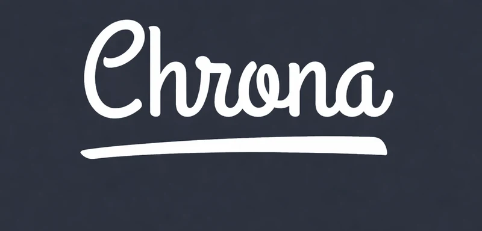
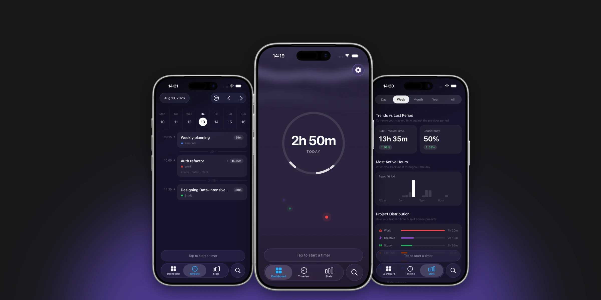
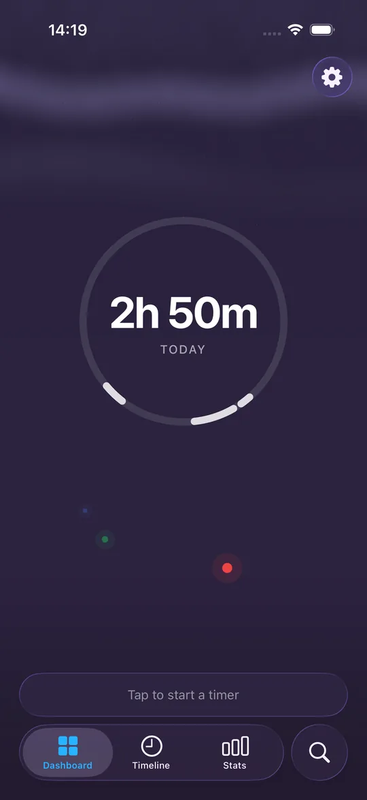
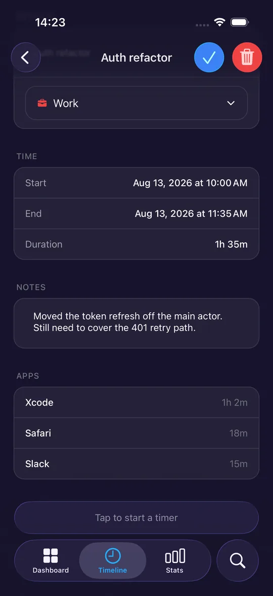
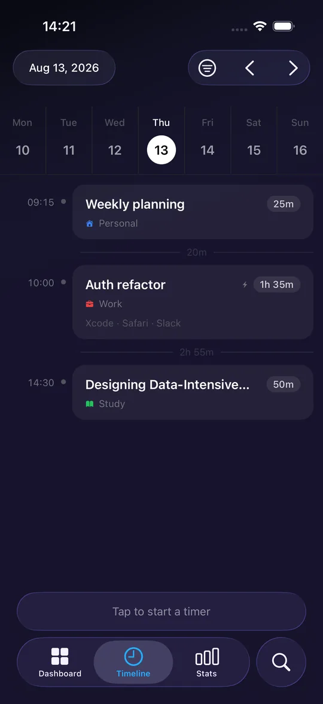
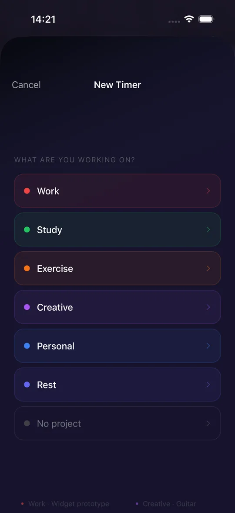
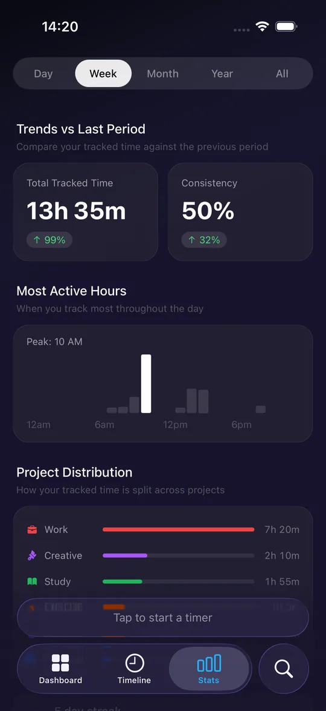
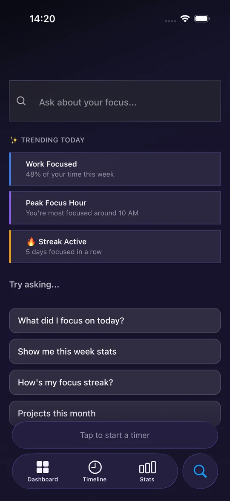
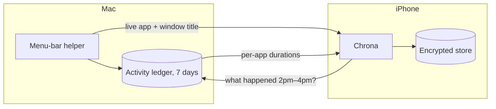

<div align="center">
  
  <p><b>A time tracker for iOS that knows what you were working on, because your Mac tells it.</b></p>
  

[](https://github.com/aexomir/Chrona/actions/workflows/ci.yml)
[](LICENSE)
</div>

## Why

Manual time trackers only work when you remember to press start, and you don't. Automatic trackers work, but what they watch is your window titles: the documents you have open, the sites you visit, the names of your private repos. The commercial ones send that to a server.

Chrona does both and keeps everything on hardware you own. You start timers yourself, or let rules start them for you. A small menu-bar app on your Mac streams which app you're in to your phone over the local network. So when you stop a timer, Chrona can tell you those two hours were 62 minutes of Xcode, 18 of Safari and 15 of Slack.

There's no account, no server and no sync. Chrona isn't on the App Store; it's a personal project you build from source.

## Screenshots

<div align="center">
  
  
  
</div>
<div align="center">
  
  
  
</div>

## What it does

- **Timers.** Pick a project, name the task, start. When you stop, you get a checklist of the apps the Mac saw during that window, and you can untick anything that wasn't really the work.
- **Auto-tracking rules.** A rule is an app name plus optional window-title keywords, pointed at a project. For example, `Xcode` + `Chrona` → Work, or `Safari` + `docs.expo.dev` → Study. A matching app starts a timer, and switching away for 15 seconds stops it. After two minutes without input on the Mac, the session is put on hold. An app you use for ten minutes with no rule shows up as a quiet hint; it's never tracked behind your back.
- **Timeline.** Your day in order, with calendar events drawn alongside your sessions. Drag one session onto another to merge them.
- **Stats.** Totals with the change from the previous period, peak hours, project split, streak and consistency.
- **Calendar.** Map a calendar to a project, and the timer bar offers to start the matching event with one tap.
- **Widgets and a Live Activity** for today's focus time and the running timer.

## How it works



The Mac helper is a Swift menu-bar app. It notices which app is frontmost, reads the focused window title, and does two things with it. It streams it live to the phone, which is what starts auto-tracked timers. It also appends it to a ledger on disk, which is what makes the per-app breakdown possible later.

A few parts I'm happy with:

- **Correct answers even when the phone wasn't listening.** When you stop a timer, the phone asks the Mac's ledger what happened in that window instead of relying on what it saw live. So the breakdown is right even if the phone was in your pocket. If the Mac is unreachable, the request is queued and retried for up to seven days.
- **It shows what it doesn't know.** A usage answer comes with a coverage breakdown: observed, idle, locked, asleep, offline or unknown, summing to the full window. The app never implies it saw more than it did.
- **Its own native module.** [`modules/chrona-stream`](modules/chrona-stream) is a local Expo module that wraps `NWBrowser` / `NWConnection`. It finds the Mac over Bonjour (`_chrona._tcp`) and speaks newline-delimited JSON over TCP. A client must present a six-character pairing code before the helper sends anything. The protocol is documented in [ChronaHelper/README.md](ChronaHelper/README.md).
- **A rule matcher that's a pure function.** [`matcher.ts`](features/auto-track/matcher.ts) takes an activity event and the rule list, and returns the best rule or nothing. More specific rules win. That makes it easy to test, and it is tested.
- **A timer bar with priorities.** The bar stays at the bottom of every tab and shows one thing, in order: an auto-tracked session, a manual one, a resumable interrupted one, a calendar suggestion, an untracked-app hint, or "Tap to start".

## Privacy

- **Nothing leaves your devices.** There's no backend and no analytics. The only network traffic is phone ↔ Mac on your local network.
- **On the phone,** everything is stored in MMKV encrypted with AES-256. The key is generated on first launch and kept in the Keychain, along with the pairing code.
- **On the Mac,** the ledger is a plain file you can open (`~/Library/Application Support/ChronaHelper/spans.ndjson`). Anything older than seven days is dropped.
- **Crash reporting is opt-in.** Sentry only starts if you set `EXPO_PUBLIC_SENTRY_DSN`.

## Tech

| | |
|---|---|
| iOS app | Expo SDK 57, React Native 0.86, TypeScript, expo-router with native tabs, React Compiler |
| UI | heroui-native, uniwind (Tailwind v4), Reanimated 4, Skia for the animated background |
| State | Zustand, persisted to encrypted MMKV |
| Mac helper | Swift, AppKit, Network.framework |
| Quality | Jest + React Native Testing Library, Maestro UI flows, GitHub Actions (typecheck, lint, tests on every PR) |
| Release | fastlane + EAS: `bun run release:ios` bumps the build and submits to TestFlight |

## Run it

You need a Mac with Xcode, [Bun](https://bun.sh), and an iPhone or the simulator. Expo Go won't work, because the app uses native tabs, widgets, calendar access and a custom native module.

```bash
git clone https://github.com/aexomir/Chrona.git
cd Chrona
bun install
cp .env.example .env
npx expo run:ios      # first build takes a while; afterwards `bun start` is enough
```

**Mac helper:**
1. Open `ChronaHelper/ChronaHelper.xcodeproj`, set your team and press ⌘R.
2. Grant Accessibility, needed for window titles; without it you only get app names.
3. Grant Local Network.
4. Click the clock icon in the menu bar for the pairing code, and enter it in the app under **Settings → Mac Helper**.

To build a `.dmg` instead, run `bash ChronaHelper/scripts/build.sh`.

**Day to day:**

```bash
bun run lint
bun run test              # Jest; plain `bun test` runs Bun's own runner instead
bun run screenshots:ios   # Maestro captures + fastlane frameit (these README images)
```

Jest covers the stats, timer, auto-track matcher and calendar logic. Maestro flows in `.maestro/` cover starting and stopping a session, and the Mac helper status. Conventions and project layout are in [CONTRIBUTING.md](CONTRIBUTING.md); longer docs are in the [wiki](https://github.com/aexomir/Chrona/wiki).

## Known gaps

- Android builds but is untested, and the Mac helper is macOS-only.
- The helper is unsigned, so on other machines Gatekeeper needs right-click → Open.
- It needs the Accessibility permission, a broad grant. That's the only way to read another app's window titles, and it's why the sandbox is off.
- No sync: two phones means two separate sets of data.
- Search is keyword matching over your own data, not a model.

## License

[Apache 2.0](LICENSE). Security issues go through [private reporting](https://github.com/aexomir/Chrona/security/advisories/new); see [SECURITY.md](SECURITY.md).
